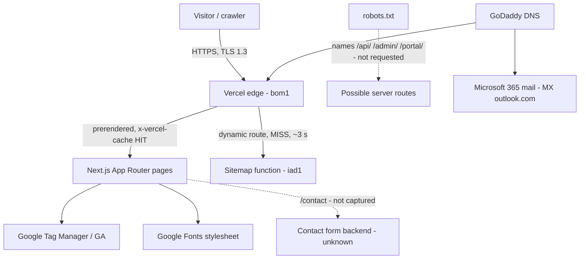
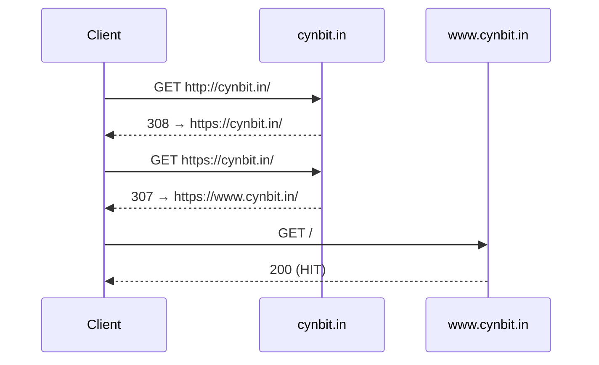

# Architecture (inferred from public observation)

## Redirect chain (NET-01)

## Proposed changes
One canonical host with a permanent redirect and canonical tag; hardening headers via `next.config.js` (CSP Report-Only first); sitemap as ISR near the audience; DKIM + DMARC `rua`. If the contact form posts to a server route: validation, rate limit, honeypot, size limit, strict CORS, consistent errors, request IDs — demonstrated with 11 tests in `src/` (**my own reference code, not Cynbit's**).
